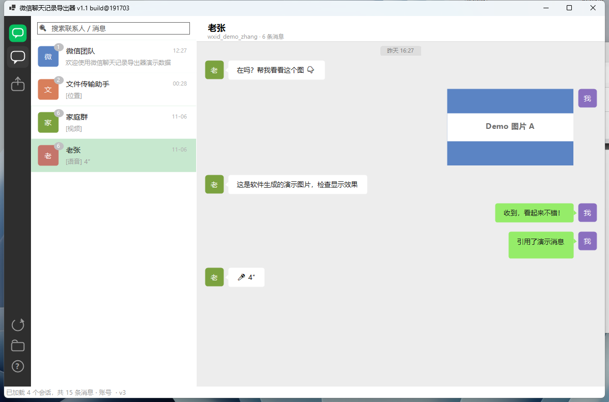
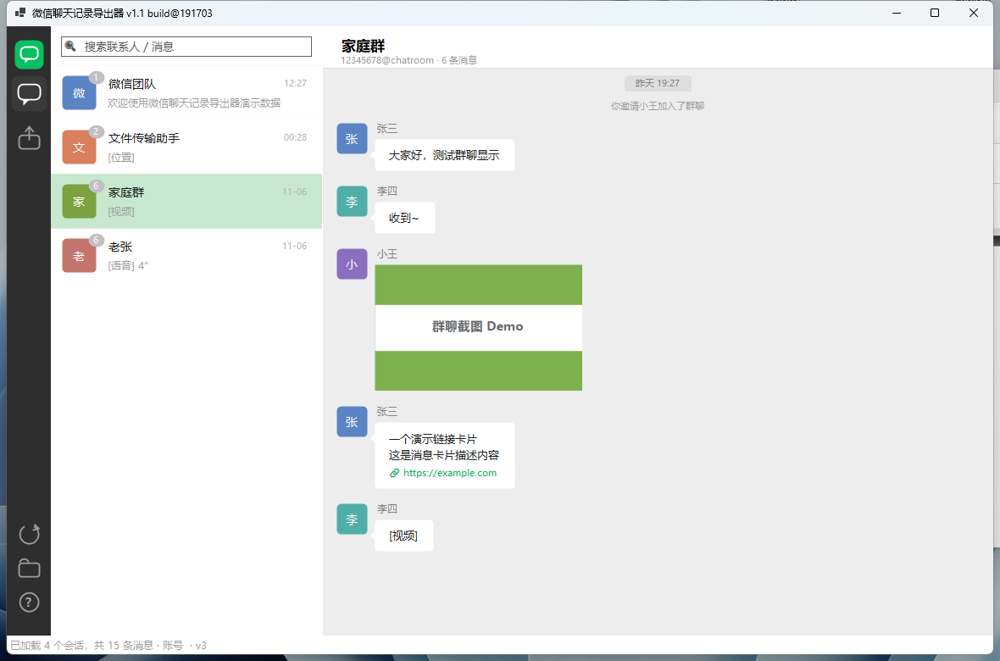

# 微信聊天记录导出器 (WeChatMsgExporter)

<p align="center"><b>绿色单文件 · 无需安装 · 不依赖 Python · 数据不出本机</b></p>

| 自动识别微信 → 解密 → 查看 → 导出 HTML |
|---|
|  |
|  |

> ⚠️ 仅用于导出与查看**本人**电脑版微信的聊天记录（个人数据备份），请遵守当地法律法规与《微信软件许可及服务协议》。

## 功能特性

- 🔍 **自动识别**：检测运行中的微信 3.x（WeChat.exe）/ 4.x（Weixin.exe），从进程内存提取数据库密钥并解密
- 📂 **手动导入**：数据库文件夹 + 64 位十六进制密钥；支持已解密数据库
- 💬 **微信风格查看器**：方圆头像、气泡（含小尾巴）、群成员昵称、图片自动解密（.dat XOR / AES）、语音/视频/名片/位置/链接卡片/引用、系统消息、时间胶囊、关键词搜索
- 📤 **导出**：**HTML**（单文件网页，微信样式，图片 base64 内嵌）、TXT、CSV
- 🧪 **演示数据**：内置按微信 v3 加密格式生成的示例库，一键体验
- ✅ **自测**：`WeChatMsgExporter.exe --selftest`，15 项断言（加解密往返 / 图片解码 / 全链路）


一款绿色的 Windows 桌面软件（单文件 exe，无需安装、不依赖 Python），用于导出并查看**本人**电脑版微信的聊天记录。

> ⚠️ 仅用于个人数据备份与查看自己的聊天记录，请遵守当地法律法规与《微信软件许可及服务协议》，勿用于未经授权的数据访问。

---

## 功能

- **自动识别**：自动检测运行中的微信（3.x `WeChat.exe` / 4.x `Weixin.exe`），从进程内存提取数据库密钥并解密聊天数据库
- **手动导入**：选择数据库文件夹 + 64 位十六进制密钥；也支持直接导入已解密的数据库（如其他工具的导出结果）
- **查看器**：微信风格聊天气泡界面——文字、图片（自动解密本地 `.dat`）、语音/视频/名片/位置/链接卡片/引用、群聊成员昵称、系统消息、日期分隔
- **搜索**：按联系人或消息关键词过滤会话
- **导出**：
  - **HTML（推荐）**：单文件网页，微信样式气泡，图片以 base64 内嵌，可直接分享/存档
  - TXT / CSV
- **演示数据**：内置一套按微信 v3 加密格式生成的示例数据库，一键体验完整流程

## 支持的微信版本

| 版本 | 进程 | 数据位置 | 密钥 |
|---|---|---|---|
| 3.x | `WeChat.exe` | `文档\WeChat Files\<wxid>\Msg\*.db` | 全局 32 字节密钥（内存提取 / 手动输入） |
| 4.x | `Weixin.exe` | `文档\xwechat_files\<wxid>\db_storage\**\*.db` | 每库独立密钥（内存自动提取） |

## 使用方法

1. **自动识别**：打开并登录电脑版微信 → 点击「自动识别微信」→ 等待解密完成，左侧选择会话即可查看
2. **手动导入**：点击「手动导入」→ 选择数据库文件夹（支持 `WeChat Files\wxid_xxx`、`db_storage` 或任意含 `.db` 的目录）→ 填入密钥（或勾选"已解密"）→ 开始导入
3. **查看**：左侧会话列表（支持搜索），右侧聊天视图；点击图片可打开原图文件，点击链接卡片可打开链接
4. **导出**：点击「导出记录」→ 选择范围（当前/全部会话）与格式 → 开始导出
5. **演示**：点击「演示数据」体验界面（也可用命令行 `WeChatMsgExporter.exe --demo` 启动时自动加载）

### 命令行

```
WeChatMsgExporter.exe --selftest            # 运行自测（加解密往返/图片解码/全链路）
WeChatMsgExporter.exe --demo                # 启动并自动加载演示数据
WeChatMsgExporter.exe --demo-export <目录>   # 生成演示数据并导出 HTML 示例
```

## 密钥说明

- 微信 3.x：密钥为 32 字节（64 位十六进制字符串），所有数据库共用。可用本软件自动提取，也可用其他开源工具获取后手动填入
- 微信 4.x：每个数据库有独立密钥，本软件通过扫描 `Weixin.exe` 内存中 WCDB 缓存的 `x'<hex>'` 密钥串自动获取，无需手动输入
- 提取密钥需要**与微信相同的权限**运行本软件（微信以管理员运行时，本软件也需管理员运行）；请保持微信已登录并打开过聊天窗口

## 隐私与安全

- 所有解密都在本地完成，解密后的数据库副本存放在 `%LOCALAPPDATA%\WeChatMsgExporter\workspace`，原始数据库文件**只读不写**
- 不联网上传任何数据（HTML 导出中的表情包图片引用微信 CDN 链接除外）
- 如需彻底清除，直接删除 `%LOCALAPPDATA%\WeChatMsgExporter` 文件夹即可

## 技术实现（供参考）

- 数据库加密：微信 3.x 为定制 SQLCipher（AES-256-CBC + HMAC-SHA1，PBKDF2 64000 轮，页尾 48 字节保留段）；4.x 为 WCDB/SQLCipher 4（AES-256-CBC + HMAC-SHA512，页尾 80 字节保留段）。本软件实现了两种格式的解密与验证，自测中包含完整加解密往返校验
- 密钥提取：3.x 在 `WeChatWin.dll` 内存中按 `iphone/android/ipad` 特征锚点回溯指针验证；4.x 正则扫描 `x'...'` 缓存串并按盐值匹配
- 消息解析：`BytesExtra` protobuf（群发送者/媒体路径）、zstd 压缩内容（v4 及 v3 的 `CompressContent`）、`.dat` 图片（XOR / AES-128-ECB 格式）
- 界面：C# WinForms 自绘（.NET 8，单文件自包含发布）

## 构建

```
cd WeChatMsgExporter
dotnet publish -c Release -r win-x64 --self-contained true ^
  -p:PublishSingleFile=true -p:IncludeNativeLibrariesForSelfExtract=true -p:EnableCompressionInSingleFile=true
```

产物：`bin\Release\net8.0-windows\win-x64\publish\WeChatMsgExporter.exe`

## 致谢

解密算法与数据结构参考了开源项目：[PyWxDump](https://github.com/xaoyaoo/PyWxDump)（MIT）、[wechat-decrypt](https://github.com/328336690/wechat-decrypt)、[WeChatMsg](https://github.com/LC044/WeChatMsg)。本项目为独立 C# 实现，仅用于个人数据导出。
